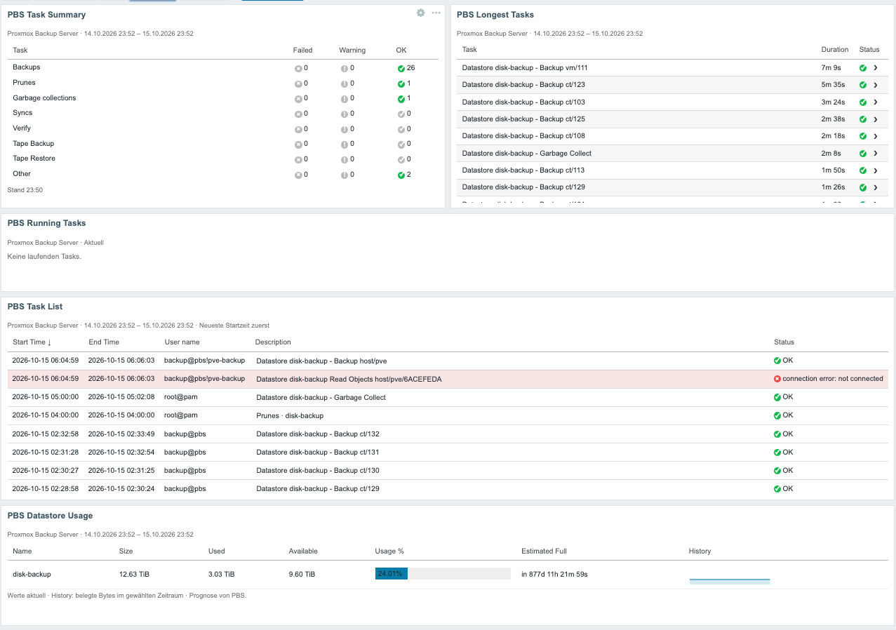

# Proxmox Backup Server Dashboard for Zabbix

Five custom Zabbix dashboard widgets for monitoring Proxmox Backup Server (PBS), together with an extended Zabbix template, data collectors, an installation/update script, and configuration examples.

This directory contains the **PBS Dashboard 1.0.5** source package. Its runtime code, template, collectors, installer, tests, and configuration example are preserved as supplied; only the package README was translated from German to English for this repository. The included template is exported in the **Zabbix 7.4** format.

## Contents

- [Features](#features)
- [Screenshot](#screenshot)
- [Requirements](#requirements)
- [Repository layout](#repository-layout)
- [Installation](#installation)
- [Zabbix template configuration](#zabbix-template-configuration)
- [Widget configuration](#widget-configuration)
- [Direct task-log access](#direct-task-log-access)
- [Updates](#updates)
- [Operational limits](#operational-limits)
- [Security notes](#security-notes)
- [License](#license)

## Features

The package provides these widgets:

- **PBS Task Summary** — counts successful, warning, and failed tasks by category and provides task details.
- **PBS Task List** — lists completed tasks with start/end time, user, description, and status. The number of rows is configurable from 1 to 1000; the default is 50.
- **PBS Longest Tasks** — shows the longest completed tasks in the selected dashboard period.
- **PBS Running Tasks** — shows currently running tasks and their runtime.
- **PBS Datastore Usage** — displays current capacity, usage, forecast data, and a history chart.

Task Summary, Task List, Longest Tasks, and Running Tasks can open PBS task logs directly from Zabbix when the optional frontend-side connection is configured. The datastore widget does not display tasks and therefore has no log action.

The extended template collects completed tasks every five minutes and running tasks every minute. Completed tasks are distributed across 16 dependent text items and retained for 90 days by the supplied template.

## Screenshot

<a href="assets/pbs-dashboard-overview.png">
  
</a>

*Example dashboard containing all five PBS widgets. Select the image to open it at full resolution.*

## Requirements

- Zabbix frontend compatible with the included Zabbix 7.4 template and manifest version 2.0 modules.
- Root access to the Zabbix frontend host for module installation.
- A monitored PBS host reachable over HTTPS, normally on TCP port `8007`.
- A PBS API token with the monitoring permissions required by the extended template. Complete task collection requires effective `Sys.Audit` permission on `/system/tasks`.
- For direct task-log access:
  - PHP cURL in the Zabbix frontend runtime;
  - HTTPS connectivity from the **Zabbix frontend/PHP runtime** to PBS;
  - a valid TLS trust path for the PBS certificate.

If the Zabbix server, proxy, and frontend run on different systems or in different containers, PBS connectivity from the server or proxy alone is not sufficient for direct log access.

## Repository layout

```text
pbs/
├── README.md                 # This project-specific guide
├── assets/                   # README screenshots
└── source/                   # PBS Dashboard 1.0.5 package
    ├── collector/            # Zabbix JavaScript task collectors
    ├── config/               # Direct-log connection example
    ├── modules/              # Five Zabbix frontend modules
    ├── templates/            # Extended Zabbix 7.4 template
    ├── tests/                # Upstream package tests
    ├── LICENSE               # GNU AGPL version 3
    ├── README.md             # Original package documentation
    ├── SHA256SUMS            # Original package integrity manifest
    └── update.sh             # Module installer/updater
```

The runtime and deployment files below `source/` are preserved exactly as supplied. `source/README.md` is an English translation of the supplied German document, and its entry in `source/SHA256SUMS` reflects the translated repository copy. Use the checksum manifest to verify the complete current tree.

## Installation

Clone the repository on the Zabbix frontend host:

```bash
git clone https://github.com/tseiman/ZabbixWidgets.git
cd ZabbixWidgets
```

Install all five frontend modules as root. On common packaged Zabbix 7.4 installations, the frontend root is `/usr/share/zabbix/ui`:

```bash
sudo sh pbs/source/update.sh /usr/share/zabbix/ui
```

The installer also accepts `/usr/share/zabbix` when the frontend is located in its `ui` subdirectory. It validates the frontend layout, refuses symbolic-link module destinations, and backs up existing PBS modules below `/var/backups/pbs-dashboard/` before copying the supplied modules. Other frontend modules are not touched.

For container installations, install the modules into a persistent frontend volume rather than the container's ephemeral filesystem.

In Zabbix:

1. Open **Administration → General → Modules**.
2. Select **Scan directory**.
3. Enable all five modules:
   - PBS Datastore Usage
   - PBS Longest Tasks
   - PBS Running Tasks
   - PBS Task Summary
   - PBS Task List
4. Perform a full browser reload with **Ctrl+F5** or **Cmd+Shift+R**.

### Install the template

For a new installation:

1. Import `pbs/source/templates/pbs-template-extended.yaml` through the Zabbix template import page.
2. Review the import comparison before applying it.
3. Keep **Delete missing** disabled when updating an existing related template, and account for local template customizations.
4. Link **Proxmox Backup Server by HTTP** to the PBS host.
5. Configure the host macros described below.
6. Run **Execute now** for:
   - `PBS dashboard: Collect completed tasks`
   - `PBS dashboard: Running tasks`
7. Check the corresponding values under **Monitoring → Latest data**. An empty task list is a valid successful result when no matching tasks exist.

## Zabbix template configuration

Configure at least these macros on the monitored PBS host:

- `{$PBS.HOST}` — PBS API hostname or IP address. Use a DNS name matching the TLS certificate whenever applicable.
- `{$PBS.PORT}` — PBS HTTPS API port; default: `8007`.
- `{$PBS.TOKEN.ID}` — PBS API token ID, for example `monitor@pbs!zabbix`.
- `{$PBS.TOKEN.SECRET}` — PBS API token secret. Store it as a secret macro.
- `{$PBS.DASHBOARD.LOOKBACK.HOURS}` — overlapping completed-task lookback from 1 to 168 hours; default: `48`.

The template also contains macros for snapshot polling and age thresholds, failed-task age, low datastore capacity, and lost-resource discovery behavior. Review those values against the local backup schedule and retention policy before relying on their alerts.

The completed-task collector deliberately verifies `Sys.Audit` on `/system/tasks`. It refuses to return a partial per-user task list when this permission is absent.

## Widget configuration

Add the desired PBS widgets to a Zabbix dashboard and select exactly one monitored PBS host in each widget.

- **Task Summary**
  - Uses the dashboard time period, with a maximum range of 90 days.
  - Supports an optional per-widget exclusion expression.
  - Default exclusion:

    ```text
    worker_type === 'reader' && status === 'connection error: not connected'
    ```

  - An empty expression disables filtering.
  - Supported fields: `worker_type`, `status`, `worker_id`, `user`, `node`.
  - Supported operators: `===`, `!==`, `&&`, `||`, `!`, and parentheses.
  - Comparisons are case-sensitive; the maximum expression length is 255 bytes.

- **Task List**
  - Uses the dashboard time period, with a maximum range of 90 days.
  - Configure between 1 and 1000 rows; default: 50.
  - Sorts completed tasks by newest start time first.

- **Longest Tasks**
  - Uses the dashboard time period, with a maximum range of 90 days.
  - Configure between 1 and 100 rows; default: 10.

- **Running Tasks**
  - Select the PBS host. No historical time-period selection is required.

- **Datastore Usage**
  - Select the PBS host and dashboard time period.

The Summary exclusion applies only to that specific Summary widget. It does not change the collectors, Task List, Longest Tasks, or Running Tasks.

## Direct task-log access

Direct logs are optional. Without this configuration, all five widgets continue to work, but task-log actions display a setup message.

The widgets intentionally do not read Zabbix secret macros in the frontend. Instead, a protected file outside the web root maps allowed Zabbix host IDs to PBS connections.

Install the example once, replacing `www-data` with the actual PHP-FPM or webserver group when necessary:

```bash
sudo install -m 0640 -o root -g www-data pbs/source/config/pbs-dashboard.example.json /etc/zabbix/pbs-dashboard.json
sudo mcedit /etc/zabbix/pbs-dashboard.json
```

If `/etc/zabbix/pbs-dashboard.json` already exists, edit it in place. Do not overwrite it with the example during an update.

Configuration format:

```json
{
  "hosts": {
    "12345": {
      "url": "https://pbs.example.invalid:8007",
      "token_id": "monitor@pbs!zabbix",
      "token_secret": "REPLACE_WITH_THE_REAL_SECRET"
    }
  }
}
```

Replace every example value:

- `12345` is the numeric **Zabbix host ID** of the monitored PBS host. It is visible as `hostid=12345` in the host-edit URL.
- `url` is the HTTPS PBS base URL without an API path, query string, or embedded credentials.
- `token_id` and `token_secret` identify a PBS token that can read all intended task logs.

Add one entry below `hosts` for each PBS host. In container deployments, mount the finished configuration persistently into the frontend container.

TLS certificate and hostname verification are always enabled. For a private CA, add a readable CA bundle to the relevant host entry:

```json
"ca_file": "/etc/zabbix/pbs-ca.pem"
```

Do not disable certificate verification. After configuration, open a known task from one of the task widgets. For HTTP `401` or `403`, check the token and its effective PBS permissions. For connection or TLS errors, test reachability and trust from the Zabbix frontend/PHP environment.

## Updates

Start only from a clean checkout, then update and reinstall the modules:

```bash
cd ZabbixWidgets
git status --short
git pull --ff-only
sudo sh pbs/source/update.sh /usr/share/zabbix/ui
```

After installation:

1. Scan the Zabbix module directory again if a new module was added.
2. Keep the required PBS modules enabled.
3. Fully reload the dashboard in the browser.
4. Preserve `/etc/zabbix/pbs-dashboard.json`; the update script does not manage this file.
5. Review release-specific instructions before importing a newer template.

For the included upgrade from 1.0.4 to 1.0.5, no template re-import is required. Existing widget IDs and settings remain unchanged. Do not delete and reinstall the template for that upgrade.

## Operational limits

- Completed tasks: collected every 5 minutes.
- Running tasks: collected every minute.
- Initial completed-task lookback: 48 hours by default, configurable from 1 to 168 hours.
- Completed-task history in the supplied template: 90 days.
- Dashboard period: maximum 90 days.
- Completed-task storage: 16 overlapping text snapshots, deduplicated by PBS UPID.
- Maximum conservative JSON size per snapshot part: 60,000 bytes.
- Maximum PBS archive response accepted by the collector: 8,000,000 characters.
- Direct log page: up to 500 lines and 2 MiB per request.
- Direct log connection timeout: 5 seconds; total timeout: 15 seconds.
- Open log display limit: 20,000 lines or 8,000,000 characters.

Task history that was not collected cannot be reconstructed later. Zabbix housekeeping, PBS task-log retention, monitoring outages, and the configured lookback all affect availability.

## Security notes

- Keep PBS tokens and secrets out of widget fields, JavaScript, commits, and screenshots.
- Restrict `/etc/zabbix/pbs-dashboard.json` to root and the actual frontend service group.
- The direct-log endpoint validates the Zabbix session, host access, and access to the required task items before contacting PBS.
- A user who can read a configured PBS host and its task items in Zabbix can read that host's PBS task logs with the permissions of the configured token.
- Configure only host mappings whose logs Zabbix users are intended to access.
- The provided endpoint reads logs only; it does not start, stop, or delete PBS tasks.
- TLS peer and hostname verification are mandatory.

## License

The supplied PBS Dashboard source package under `source/` includes the **GNU Affero General Public License version 3** in `source/LICENSE`. This project-specific guide does not replace or modify that license.