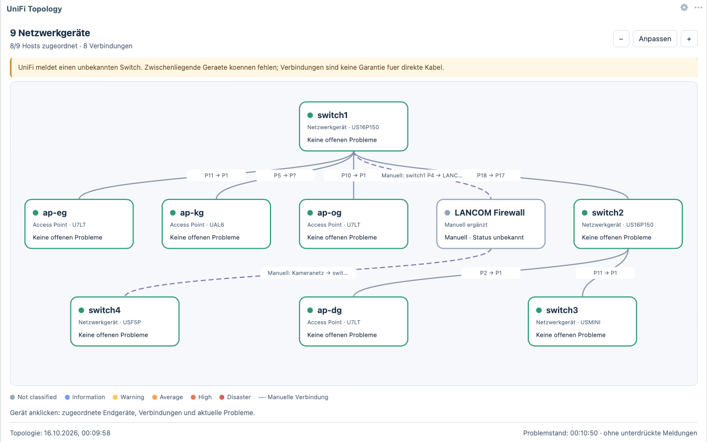

# UniFi Network Topology for Zabbix

A read-only Zabbix 7.4 dashboard widget that visualizes a UniFi Network topology, links network devices to Zabbix hosts, overlays the current Zabbix problem severity, and shows per-device RX/TX traffic history. The accompanying template collects both topology and per-port device statistics from the UniFi controller.

This directory contains **UniFi Network Topology 0.3.4** and its **Zabbix 7.4** template. Version 0.3.4 adds module-local English and German frontend translations selected from the logged-in Zabbix user's language. German variants (`de`, `de_DE`, and `de-DE`) use German; English and unsupported languages use the English source fallback. The manual-only traffic-chart rule from 0.3.3 is unchanged: every automatically discovered device retains its mini chart.

## Contents

- [Features](#features)
- [Screenshot](#screenshot)
- [Requirements](#requirements)
- [Repository layout](#repository-layout)
- [Install the topology template](#install-the-topology-template)
- [Install the frontend module](#install-the-frontend-module)
- [Configure the widget](#configure-the-widget)
- [Traffic charts and data](#traffic-charts-and-data)
- [Host mapping](#host-mapping)
- [Manual devices and connections](#manual-devices-and-connections)
- [Status and problem colors](#status-and-problem-colors)
- [Updates](#updates)
- [Operational limits](#operational-limits)
- [Security and permissions](#security-and-permissions)
- [Removal](#removal)
- [License](#license)

## Features

- Draws UniFi entries with `type=DEVICE` as network nodes.
- Displays automatic wired and wireless connections from the UniFi topology response.
- Shows port numbers, link rates, SSIDs, channels, and experience values when UniFi supplies them.
- Shows a compact, individually bound RX/TX chart in the upper-right corner of every automatically discovered UniFi network node; nodes without history open an explicit empty state instead of fabricated values. Manually added topology nodes do not receive a traffic icon.
- Opens an accessible, automatically scaled RX/TX chart dialog using the current dashboard time period.
- Expands a selected device to show directly attached clients, network links, and open Zabbix problems.
- Uses Zabbix's configured severity names and colors.
- Supports exact automatic host-name mapping and explicit MAC-to-host-ID mapping.
- Supports up to 50 optional manual nodes and 100 manual links per widget.
- Marks stale topology or problem data instead of presenting old status as current.
- Performs no direct browser-to-UniFi requests and uses no external JavaScript libraries or CDNs.
- Does not create or modify Zabbix maps, hosts, items, triggers, or UniFi configuration.

The module reads the latest value of the selected `UniFi topology: Raw JSON` text item. Problem, host, traffic-item, history, and trend information is queried through the current frontend user's Zabbix API context. Chart data is reduced to at most 320 points per underlying item before it reaches the browser.

## Screenshot

<a href="assets/unifi-network-topology-overview.png">
  
</a>

*Example topology with automatic UniFi links, manually added connections, host mapping, and Zabbix problem-state colors. Select the image to open it at full resolution.*

## Requirements

- Zabbix 7.4 frontend with support for manifest version 2 widget modules.
- Administrative access to install and enable a frontend module.
- The supplied `UniFi Network Topology` template linked to the UniFi controller host.
- Existing effective host macros:
  - `{$UNIFI_NETWORK_API_ADDRESS}` — hostname or IP address, optionally followed by a port; no `https://` prefix and no path.
  - `{$UNIFI_NETWORK_API_KEY}` — UniFi API key, preferably stored as a Zabbix secret macro.
- DNS and HTTPS connectivity from the responsible Zabbix server or proxy to the UniFi controller.
- A TLS certificate trusted by the responsible Zabbix server or proxy and matching the configured controller name.
- Read access for dashboard users to the topology item and to any Zabbix hosts whose problem status should be displayed.

The supplied template uses the UniFi site name `default` in both request URLs. For another site, change `/site/default/` and `/s/default/` in the two HTTP-agent items before linking the template, then review the import diff deliberately.

## Repository layout

```text
.github/workflows/unifi-network-package.yml       # Builds and publishes the rolling package
unifi-network/
├── .gitignore
├── README.md
├── install.sh                                    # Installs from a checkout or extracted package
├── scripts/build-install-archive.sh              # Creates TAR.GZ plus SHA-256 sidecar
├── assets/                                       # README screenshots
├── tests/                                        # Regression and package-installation tests
└── source/
    ├── docs/original/                            # Supplied historical Markdown documents
    ├── modules/unifi_topology/                   # Widget source 0.3.4
    │   ├── actions/
    │   ├── assets/
    │   ├── includes/
    │   ├── views/
    │   ├── INSTALL_PROXMOX.md
    │   ├── MANUAL_TOPOLOGY.md
    │   ├── README.md
    │   ├── Widget.php
    │   └── manifest.json
    └── templates/
        └── unifi_network_topology_zabbix74.yaml
```

The supplied standalone HTML previews are intentionally not included because they embed a historical topology snapshot with device names and MAC addresses. The nested ZIP is also omitted because its unchanged contents are available directly below `source/modules/unifi_topology/`.

The files below `source/docs/original/` document older imported releases and are retained only as historical source material. Use this guide for current installation and behavior.

## Install the topology template

Obtain the template either from the installation archive described in [Install the frontend module](#install-the-frontend-module), or clone the repository:

```bash
git clone https://github.com/tseiman/ZabbixWidgets.git
cd ZabbixWidgets
```

The template path is:

- extracted archive: `unifi_topology-*/template/unifi_network_topology_zabbix74.yaml`
- repository checkout: `unifi-network/source/templates/unifi_network_topology_zabbix74.yaml`

In Zabbix:

1. Open **Data collection → Templates → Import**.
2. Import the template from the applicable path above.
3. On the first import, allow creation of the template and the `Templates/UniFi Topology` template group.
4. Keep **Delete missing** disabled.
5. Review the import preview. It should contain six regular items, one discovery rule, and six item prototypes.
6. Link **UniFi Network Topology** to the existing UniFi controller host. Do not link it to every discovered UniFi device host.
7. Check the effective `{$UNIFI_NETWORK_API_ADDRESS}` and `{$UNIFI_NETWORK_API_KEY}` values under inherited and host macros. The topology template deliberately does not define or override them.
8. Run **Execute now** for both `UniFi topology: Raw JSON` and `UniFi devices: Raw JSON`.
9. Wait for low-level discovery, then open **Monitoring → Latest data**. Confirm topology values and RX/TX items for the expected switches and access points.

The template creates these items:

- `unifi.topology.json` — HTTP-agent master item, queried every minute.
- `unifi.topology.vertices` — complete `vertices` array as dependent text.
- `unifi.topology.edges` — complete `edges` array as dependent text.
- `unifi.topology.vertices.count` — number of all returned vertices.
- `unifi.topology.edges.count` — number of all returned edges.
- `unifi.devices.json` — HTTP-agent master item for `/proxy/network/api/s/default/stat/device`, queried every minute.
- `unifi.device.discovery` — dependent low-level discovery for devices with UniFi types `usw` and `uap`.
- `unifi.device.rx.rate.bps[MAC]` and `unifi.device.tx.rate.bps[MAC]` — preferred direct rates in bit/s.
- `unifi.device.rx.counter.bytes[MAC]` and `unifi.device.tx.counter.bytes[MAC]` — short-lived aggregate byte counters used by the fallback.
- `unifi.device.rx.counter.bps[MAC]` and `unifi.device.tx.counter.bps[MAC]` — rate fallback derived with change-per-second preprocessing.

The dependent items do not cause additional controller requests. The template makes one topology request and one device-statistics request per minute. Vertex and edge counts are inventory counts, not reachability or health indicators.

## Install the frontend module

The recommended installation artifact is published on the rolling [UniFi Network release page](https://github.com/tseiman/ZabbixWidgets/releases/tag/unifi-network-latest). Every push that changes `unifi-network/` rebuilds the package. The release retains only the newest versioned archive and its SHA-256 sidecar.

Download both files into an otherwise empty directory. Verify the archive before extracting it:

```bash
cd ~/Downloads/unifi-topology
archive=$(find . -maxdepth 1 -type f -name 'unifi_topology-*.tar.gz' -print)
test -n "$archive"
test "$(printf '%s\n' "$archive" | grep -c .)" -eq 1
sha256sum -c "$archive.sha256"
```

Continue only when `sha256sum` reports `OK`. The checksum proves integrity relative to the downloaded sidecar; obtain both files from the intended HTTPS release and confirm the release tag. Extraction is deliberately a separate command:

```bash
tar -xzf "$archive"
package_dir=${archive%.tar.gz}
sudo "$package_dir/install.sh"
```

The default module root is `/usr/share/zabbix/ui/modules`, producing:

```text
/usr/share/zabbix/ui/modules/unifi_topology/manifest.json
```

To use another confirmed Zabbix frontend module root, pass that parent directory as the only argument:

```bash
sudo "$package_dir/install.sh" /opt/zabbix/ui/modules
```

Do not pass the existing `unifi_topology` directory itself. The installer appends that name, rejects symbolic-link targets, stages a complete replacement on the same filesystem, and rolls back if the replacement cannot be completed. It uses directory mode `0755` and file mode `0644`. Markdown documentation is not packaged or installed, so an update also removes documentation left by the old standalone package. No persistent backup is created automatically.

The same installer can be run directly from a repository checkout:

```bash
git clone https://github.com/tseiman/ZabbixWidgets.git
cd ZabbixWidgets
sudo ./unifi-network/install.sh
```

For multiple frontend instances, install the same module on every instance. In containers, install it into a persistent frontend volume; a copy made only inside a running container disappears when the container is recreated.

In Zabbix:

1. Open **Administration → General → Modules** as a Super Admin.
2. Select **Scan directory**.
3. Enable **UniFi Network Topology**, or verify the detected version after an update.
4. Fully reload the dashboard page.

No Zabbix server restart and no additional API token are required. If an enabled PHP OPcache retains old files, refresh it using the site's normal administrative procedure.

## Configure the widget

Edit a dashboard and add **UniFi Network Topology**. The widget controls, statuses, warnings, errors, ARIA labels, and empty states follow the logged-in user's English or German language. Configure:

- **Topology master item** (**Topologie-Master-Item** in German) — select `UniFi topology: Raw JSON` on the controller host.
- **Traffic time period** (**Traffic-Zeitraum** in German) — keep **Dashboard** selected to follow the dashboard time selector; a custom period can be chosen per widget if required.
- **Refresh interval** — normally one minute, matching the template item.
- **Exact Zabbix host name with `{name}`** — mapping pattern described below.
- **Optional mapping** — explicit `MAC=Host-ID` entries.
- **Additional devices** — optional manual nodes.
- **Additional connections** — optional manual links.
- **Maximum topology age** — 60 to 86,400 seconds; default: 300 seconds.
- **Include suppressed problems** — disabled by default.

The widget displays only topology nodes whose JSON `type` is `DEVICE` in the main graph. UniFi clients, including client-classified cameras, appear in the selected device's detail panel instead.

## Traffic charts and data

Each switch or access point with collected history receives a small chart in the upper-right corner of its topology node. Blue is RX and green is TX. Select the chart with a pointer, or focus it and press **Enter** or **Space**, to open the larger dialog. The dialog uses the same time period as the mini chart and automatically chooses a readable linear bit/s scale.

The widget does not query UniFi from the browser. It resolves the traffic items on the same controller host as the selected topology master item, then uses Zabbix's history manager to retrieve bounded, pixel-width-aggregated data. Detailed history is used while retained; older dashboard periods use Zabbix trends. A direction with no data is omitted, and a node receives no chart until at least one direction has history.

Traffic calculation rules:

- Preferred value: `8 × sum(rx_bytes-r)` and `8 × sum(tx_bytes-r)` across unique physical ports.
- Fallback: changes per second of the summed cumulative `rx_bytes` and `tx_bytes` counters, multiplied by eight.
- A positive `port_idx` or `num_port` identifies a physical port. Duplicate indexes are counted once.
- Interfaces identified as `lag`, `bond`, or `aggregate`, and interfaces named `lag*` or `bond*`, are excluded to avoid adding a logical aggregate to its member ports.
- If an access point has no usable `port_table` value, its single physical `uplink` rate or counter is used.
- Negative, missing, non-numeric, and otherwise unusable values are not converted into zero. Zabbix retains a gap instead.

The chart is the sum of device-port traffic, not WAN utilization and not the sum of attached-client statistics. RX and TX are shown separately; the visual scale covers the larger of the two. Manually added nodes do not receive traffic charts because they have no matching discovered UniFi item.

## Host mapping

Host mapping lets a topology node display real problems from its corresponding Zabbix host.

### Exact name pattern

The default pattern is:

```text
UniFi Network - Site: "Default" - Device: "{name}"
```

`{name}` is replaced exactly with the device name from the UniFi topology JSON. The widget checks both the technical and visible Zabbix host names, without fuzzy substring matching. The pattern must contain `{name}` exactly once, or be empty.

If no host is found, more than one host matches, or one host would be attached to multiple topology nodes, the affected node remains gray with an unknown mapping status.

### Explicit MAC mapping

Use one line per device:

```text
aa:bb:cc:dd:ee:ff=12345
```

Replace the example with the real UniFi device MAC address and numeric Zabbix host ID. Comments start with `#`. Explicit mapping takes precedence over the name pattern. Clear the name pattern to use explicit mappings exclusively.

## Manual devices and connections

The widget can add non-UniFi or missing infrastructure to one dashboard without changing the source JSON or Zabbix objects.

### Additional devices

Use one line per node:

```text
id | Display name | optional Zabbix host ID
```

Example:

```text
internet | Internet
firewall | Firewall | 12345
remote_site | Remote site
```

Rules:

- IDs begin with a lowercase letter and contain lowercase letters, digits, `_`, or `-`.
- IDs are at most 40 characters.
- Display names are at most 100 characters and cannot contain `|`.
- A positive numeric Zabbix host ID is optional.
- Without a host ID, the widget shows **Manual · status unknown** rather than inventing a healthy state.

### Additional connections

Use one line per link:

```text
from | to | optional label
```

An endpoint is either a manual node ID or the real MAC address of a UniFi network device. Example values below are placeholders:

```text
internet | firewall | WAN
firewall | aa:bb:cc:dd:ee:01 | Internal LAN
```

Manual links are dashed and marked as manual. An automatic UniFi link between the same endpoints takes precedence. Missing endpoints produce a visible warning and leave the saved configuration intact.

Empty lines and lines beginning with `#` are ignored. Duplicate IDs, duplicate links, self-links, invalid host IDs, and malformed endpoints are rejected when the widget is saved.

## Status and problem colors

- The highest severity among currently visible open problems determines the node border color.
- Severity names and colors come from the Zabbix configuration.
- Acknowledging a problem does not remove it. The highlight disappears after the problem is resolved and the widget refreshes successfully.
- Suppressed problems are excluded by default and can be enabled per widget.
- Selecting a problem opens its Zabbix event.
- Green means that the uniquely mapped, monitored host has no open problems visible to the current user under the selected filter. It is not an independent availability measurement.
- Missing or ambiguous mappings, disabled host monitoring, manually added nodes without a host, and stale status are gray.
- Existing open problems remain visible when host monitoring is disabled.
- API or frontend errors replace the status with an error instead of displaying old data as current.

Gray connection lines represent topology only. They are not port alarms. Device problems color the device, not its links.

## Updates

For an archive-based installation, download the current archive and checksum from the rolling release into a new empty directory, repeat the checksum gate, extract it, and run its installer. The installer replaces only the `unifi_topology` module directory and removes stale files from the former package.

For a repository checkout, start with a clean worktree and update it:

```bash
cd ZabbixWidgets
git status --short
git pull --ff-only
```

Before a production update, retain an operator-controlled backup:

```bash
sudo tar -czf /var/backups/unifi_topology-$(date +%Y%m%d-%H%M%S).tar.gz \
  -C /usr/share/zabbix/ui/modules unifi_topology
```

Then deploy the current source using the same installer as the archive:

```bash
sudo ./unifi-network/install.sh
```

For a non-default module root, pass the confirmed parent directory again. Then scan the module directory in Zabbix and fully reload the dashboard. Keep the module directory name and module ID `unifi_topology`; existing master-item selection, mappings, manual topology, and refresh settings are stored with the dashboard widget.

**Version 0.3.0 requires the updated template.** Import `unifi_network_topology_zabbix74.yaml` with **Delete missing** disabled, review the comparison, and execute both HTTP-agent master items. The topology remains usable during low-level discovery, but traffic charts appear only after the new items have collected history.

## Operational limits

- Automatic topology: at most 1,000 vertices and 3,000 edges per response.
- Open problems: at most 2,000; the widget rejects an incomplete result rather than silently truncating status.
- Manual topology: at most 50 nodes and 100 links per widget.
- Manual input line: at most 500 bytes.
- Manual link label: at most 150 characters.
- Default stale-data threshold: 300 seconds.
- Widget zoom range: 60% to 240%.
- Template request interval: one minute.
- Raw topology and dependent text history: one day.
- Count history: 30 days; count trends: 365 days.
- Raw device-statistics history: one hour.
- Aggregate byte-counter history: one hour; no trends.
- Direct and counter-derived traffic-rate history: 30 days; trends: 365 days.
- Chart transfer limit: at most 320 aggregated points per underlying traffic item and dashboard refresh.

The UniFi topology and device-statistics endpoints are internal and may change with controller updates. The template requires HTTP 200, rejects redirects, and verifies both TLS peer and host name. On collection failure, Zabbix retains previous item values; always check timestamps and item support state when diagnosing stale topology or chart gaps.

If UniFi reports `has_unknown_switch=true`, the widget warns that intermediate devices may be missing. The warning can be dismissed for the current dashboard page and returns after a full page reload. Manual additions do not prove that the automatic topology is complete.

## Security and permissions

- Topology and device-statistics collection performs HTTPS `GET` requests only.
- Store `{$UNIFI_NETWORK_API_KEY}` as a secret host macro.
- The browser does not receive or use the UniFi API key.
- The widget performs no direct database queries and makes no direct browser-side requests to UniFi.
- Host and problem lookups use the logged-in frontend user's Zabbix API permissions.
- Users need read access to the topology item, the controller host's traffic items, and each mapped host whose problems they should see.
- Do not use disabled TLS verification as a permanent workaround. A successful `curl -k` request does not prove that Zabbix can validate the controller certificate.
- No external CDN, JavaScript library, or additional service is used.

## Removal

1. Remove the widget from dashboards.
2. Disable **UniFi Network Topology** under **Administration → General → Modules**.
3. Remove the `unifi_topology` module directory only after it is disabled.

Removing the frontend module does not remove or modify the topology template or collected item data.

## License

No project-specific license file was included with the supplied UniFi widget package. See the repository-level [LICENSE](../LICENSE) for the repository's license information.